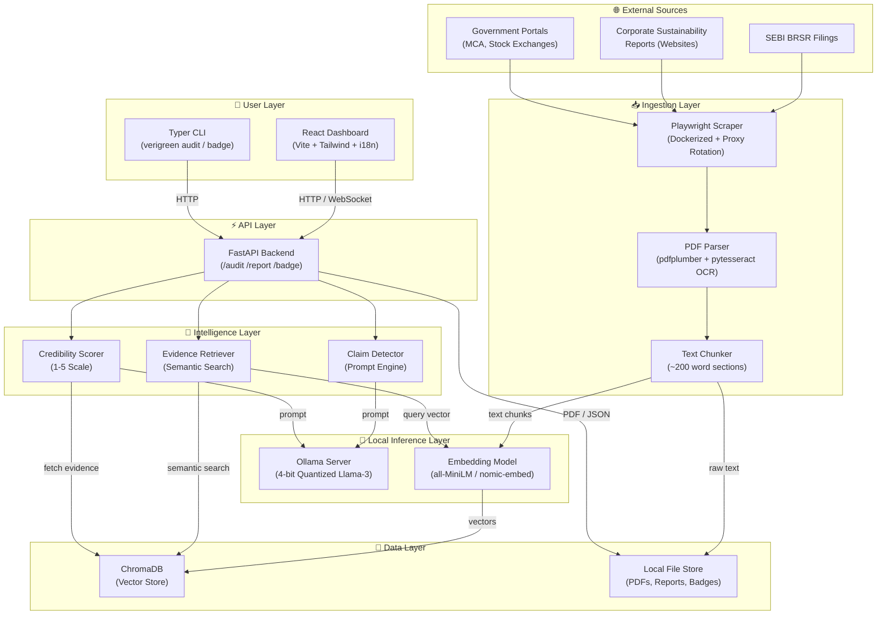
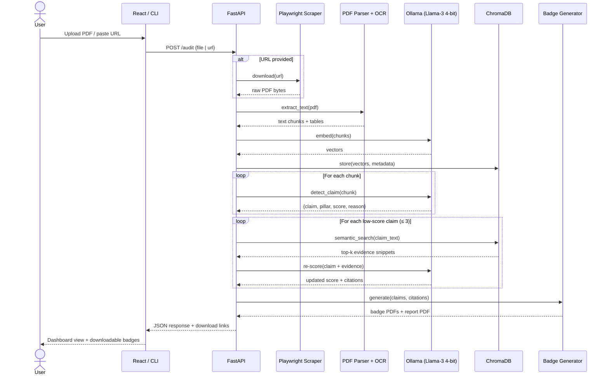
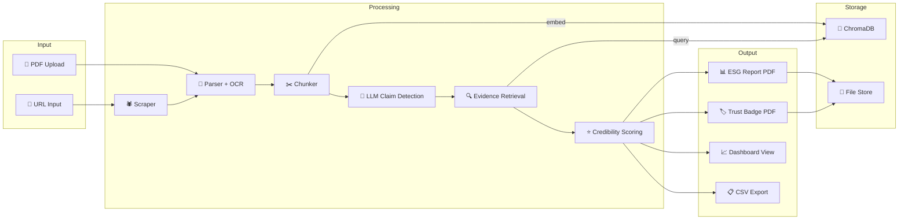

# VeriGreen AI – Agentic ESG Audit

**Hackathon project** built to automatically verify ESG claims from corporate disclosures using a **local, zero‑cloud‑cost LLM**.

- Scrapes PDFs (SEBI BRSR, sustainability reports) via Playwright.
- Performs **claim detection**, **pillar classification**, and **evidence‑backed credibility scoring** with a 4‑bit quantized Llama‑3 (Ollama).
- Stores semantic vectors in **ChromaDB** for fast retrieval.
- Generates **trust‑badge PDFs** and a full audit report (HTML/PDF/CSV).
- Provides a **React dashboard** and a **Typer CLI**.
- Multilingual UI & zero OPEX – ideal for civic watchdogs, investors, regulators, and corporate ESG teams.

---

## System Design

### High‑Level Architecture



### Request Flow (Single Audit)



### Component Interaction Map



---

## Tech Stack

| Layer | Technology | Purpose |
|-------|-----------|---------|
| **Scraper** | Playwright (Docker) | Headless browsing, proxy rotation, anti‑bot evasion |
| **PDF Extraction** | pdfplumber + pytesseract | Tables, scanned text, multilingual OCR |
| **LLM** | Ollama + 4‑bit Llama‑3 | Local inference, zero cloud cost |
| **Embeddings** | all‑MiniLM / nomic‑embed via Ollama | Fast semantic vectors |
| **Vector Store** | ChromaDB (SQLite) | Embeddable, Docker‑friendly |
| **API** | FastAPI (Python) | Async, auto‑docs (Swagger) |
| **CLI** | Typer | One‑liner audit commands |
| **Frontend** | React + Vite + Tailwind CSS | Responsive, i18n‑ready dashboard |
| **Badge/Report** | ReportLab | PDF generation with citation links |
| **Orchestration** | Docker Compose | Single‑command dev/prod environment |

---

## Quick Start (coming soon)
```bash
docker compose up --build
# Dashboard  → http://localhost:3000
# API docs   → http://localhost:8000/docs
# CLI        → verigreen audit sample.pdf
```
